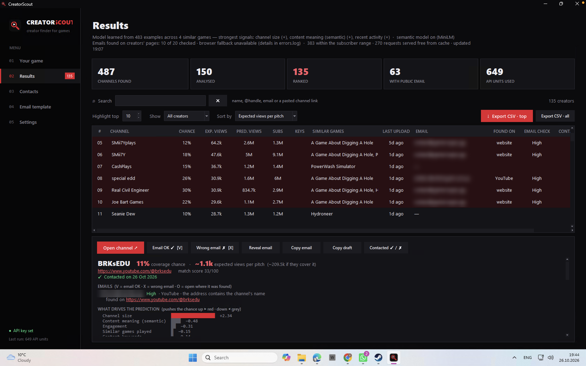
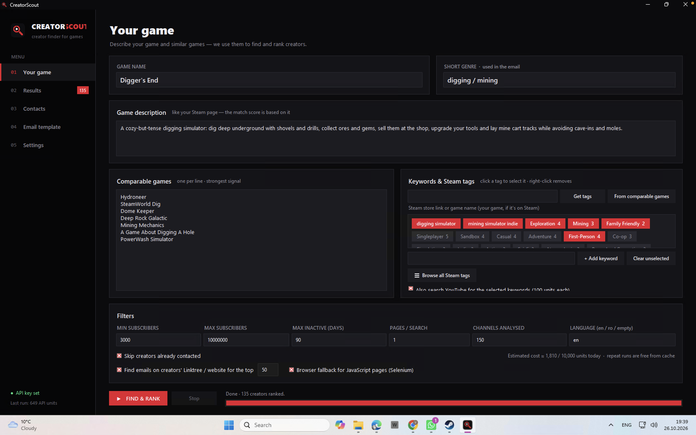
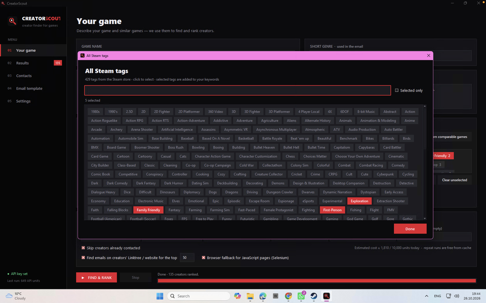
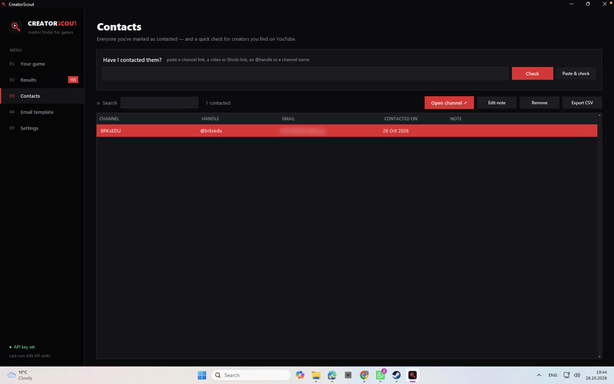

# CreatorScout

**Find the YouTube creators most likely to cover your indie game, ranked by how many views a single pitch is expected to bring, with the public contact details to reach them.**

CreatorScout is a Windows desktop app built for indie game marketing. You describe your game and a few comparable games. It searches YouTube through the official API, analyses every channel it finds, learns what predicts coverage in your genre, and gives you a ranked, explainable shortlist you can export to CSV.



---

## Features

- **Discovery from comparable games.** It finds the channels that already played games like yours, which is the strongest signal of interest.
- **Game detection beyond titles.** It looks at the last 100 uploads per channel (configurable up to 500) and recognises a game from:
  - the video title;
  - the video's tags;
  - the exact name in the description;
  - the game's Steam store link in the description.

  On simulated channels this finds 85% of the real coverage, versus 8% when matching titles in the last 30 uploads only.
- **Prediction for every creator:**
  - **Coverage chance:** how likely a channel like this is to cover a game like yours.
  - **Predicted views:** what a video about your game would probably get.
  - **Expected views per pitch:** chance × predicted views × reachability. This is the default sort order.
- **A self-calibrating model.** Each search trains a small model on the public YouTube coverage of your genre, so the weights fit your niche instead of being hard-coded.
- **Semantic matching** with a pretrained sentence-embedding model (MiniLM), combined with TF-IDF keyword matching.
- **Explanations.** Every creator shows what pushed the prediction up or down, which similar games they played, and how those videos performed.
- **Public contact details:**
  - emails from YouTube descriptions, plus the creator's own Linktree or website (with a headless-browser fallback for JavaScript pages);
  - every email rated High / Medium / Low with a reason, and helpdesk, merch and platform addresses rejected automatically;
  - a fast manual review mode (`V` = OK, `X` = wrong, `O` = open the page where it was found), remembered across runs.
- **Contacts tracker.** Paste any YouTube link, @handle or name to see instantly whether you've already contacted that creator. Includes notes and CSV export.
- **"Why isn't X in the list?"** It explains exactly where a channel dropped out, and can analyse and add it on demand.
- **Steam tags as keywords:**
  - pull tags from your game's Steam page, or the tags your comparable games share;
  - browse the full Steam tag list;
  - add your own keywords.
- **Search, sort and filter** by any column. Natural A–Z sort, subscribers, contacted date, email confidence.
- **Quota-aware.** The free YouTube quota is 10,000 units a day. A full search costs about 1,000–2,000 units, and repeat runs are almost free thanks to a local cache.

| | |
|---|---|
|  |  |
|  | |

*Emails in the screenshots are blurred.*

---

## How it works

```
Your game + comparable games
  └─ 1. Discover      search.list "<game> gameplay"          (100 units per game)
  └─ 2. Channels      channels.list, subscriber filter       (1 unit per 50 channels)
  └─ 3. Analyse       last 100 uploads: views, tags, descriptions  (~4 units per channel)
  └─ 4. Signals       TF-IDF + MiniLM, similar games, genre performance,
                      accepted dev keys, size, engagement, activity
  └─ 5. Predict       logistic regression trained on this genre's public coverage
  └─ 6. Emails        descriptions → creator's own links → manual review
  └─ Results          ranked table, explanations, CSV export
```

### The coverage model

There is no public dataset of "which creators cover which indie games", so the app builds one from YouTube itself on every search:

1. **Hide one game, learn, repeat.** For each comparable game it already knows which analysed channels covered it. It hides one game at a time, computes every channel's signals *without* that game, and learns which signals predict that the channel covered it (leave-one-game-out labels).
2. **Correct for discovery bias.** Every channel was found *through* some game. When the hidden game is the one a channel was found through, that channel looks like it covered the game "with no other evidence". So, for each hidden game, the model only learns from channels that would have been found without it.
3. **Fit the model.** It is an L2-regularised logistic regression on standardised signals, written in plain Python. It trains in under a second.
4. **Fall back when needed.** If there is too little data, it uses sensible default weights and says so.
5. **Guard against off-topic channels.** A relevance factor keeps big off-topic channels from riding on size alone.

On simulated data with a known ground truth, the model is well calibrated: when it predicts 52%, the true rate is 49%. Its AUC is 0.78, close to the theoretical best of 0.80. In a genre where the default intuitions are wrong, it learns the right direction by itself and beats the default weights.

### Semantic matching

Content similarity combines TF-IDF (implemented from scratch, game names removed so they are not double-counted) with **all-MiniLM-L6-v2**, a pretrained sentence-embedding model. It runs as a quantised ONNX model through `onnxruntime`, with no PyTorch, and is downloaded once (~23 MB). If it is unavailable, the app falls back to TF-IDF only.

### Email precision

- **Only the creator's own links are followed:** links in the channel description, or links repeated in at least 3 video descriptions (their standard footer). One-off links in a single video (sponsors, game pages) are ignored.
- **Clearly unrelated addresses are dropped:** helpdesks, game companies, platforms, and `support@`, `merch@`, `orders@`, `noreply@` and similar.
- **Every remaining email gets a confidence level:**
  - **High:** it contains the channel's name, is on the creator's own domain, or is written in their channel description with business context.
  - **Medium:** a personal mailbox or an agency address without a name match.
  - **Low:** an unrelated domain.
- **The YouTube About-tab email stays manual.** It sits behind a CAPTCHA and is never bypassed; the **Reveal email** button opens it so you can copy it by hand.

---

## Getting started

### 1. YouTube API key (free, ~3 minutes)

1. Go to [console.cloud.google.com](https://console.cloud.google.com) and create (or pick) a project.
2. Go to **APIs & Services → Library**, search for **YouTube Data API v3** and click **Enable**.
3. Go to **Credentials → Create credentials → API key**.
4. Optional but recommended: **Edit API key → API restrictions → Restrict key**, then tick only YouTube Data API v3.
5. Paste the key into the app's **Settings** page.

### 2. Build the app (Windows)

Double-click **`build_exe.bat`**. It:

- picks a compatible Python (3.10–3.13, which the ML libraries need);
- creates a virtual environment and installs the dependencies;
- builds **`CreatorScout.exe`** with PyInstaller.

On newer Python versions without `onnxruntime` wheels, it still builds, just without the semantic model.

You can also run from source with `run_from_source.bat`, or `python app.py` after `pip install -r requirements.txt`.

On **macOS**, run `Build app (Mac).command`.

Every push to GitHub also builds the `.exe` automatically: see **Actions → latest run → Artifacts**.

### 3. Use it

1. **Your game:** fill in the name and a Steam-style description, list 5–15 comparable games, and pick keywords or Steam tags.
2. **FIND & RANK.**
3. **Results:** sort, search, open a creator to see why they rank where they do, and review emails.
4. **Export CSV:** send personalised emails by hand, using the generated draft as a starting point.

---

## Data & privacy

- **It uses only public data:** the official YouTube Data API and public pages the creator links to. It respects `robots.txt` and never bypasses CAPTCHAs or logins.
- **Everything is stored locally** in `%APPDATA%\CreatorScout\`: the API key, cache, contacted list and email reviews. None of it is in the repository.
- **Exported CSVs contain personal data (emails)** and are git-ignored. Use them only for outreach, and honour any request not to be contacted (GDPR).
- **Send emails one by one, personalised.** Bulk mailing gets flagged as spam and doesn't work for indie outreach anyway.

---

## Tests

```
python tests/test_pipeline.py        # ranking, filters, quota cost, cache, quota exhaustion
python tests/test_integration.py     # full pipeline on a simulated YouTube with known ground truth
python tests/test_model.py           # calibration, AUC vs. theoretical best, learns when defaults are wrong
python tests/test_embed.py           # tokenizer → ONNX → mean pooling → cosine
python tests/test_enrich.py          # Linktree, contact pages, Cloudflare emails, robots.txt, JS pages
python tests/test_email_precision.py # real-world false positives (helpdesk, merch, sponsor links)
python tests/test_lookup.py          # every YouTube link format, DB migration, API resolution
python tests/test_explain.py         # "why isn't X in the list?", adding a channel by hand
python tests/test_steam.py           # Steam store tags, SteamSpy fallback, full tag list
python tests/test_coverage_sources.py # games found in tags / descriptions / Steam links, older uploads
```

The tests run against a simulated YouTube API that answers in the real JSON format, so no API key or internet connection is needed.

---

## Project structure

| File | Purpose |
|---|---|
| `app.py` | Tkinter UI: pages, table, dialogs, background thread with a message queue |
| `scout.py` | Pipeline: discovery → analysis → signals → prediction → explanations |
| `model.py` | Self-calibrating coverage model (leave-one-game-out logistic regression) |
| `embed.py` | Pretrained MiniLM sentence embeddings via ONNX Runtime |
| `youtube_api.py` | YouTube Data API v3 client: cache, retries, quota accounting, batching |
| `contacts.py` | Email and link extraction, email confidence rating, creator-owned links |
| `enrich.py` | Emails from creators' own pages (`requests`, Selenium fallback) |
| `lookup.py` | Understands any YouTube link, @handle or name for the contacts check |
| `steam.py` | Steam store tags, full tag list, SteamSpy fallback |
| `storage.py` | SQLite (cache, contacts, email reviews) and JSON settings |

## Tech stack

Python · Tkinter/ttk · YouTube Data API v3 · SQLite · NumPy · ONNX Runtime + Hugging Face Tokenizers (MiniLM) · Selenium · PyInstaller · GitHub Actions

## Limitations

- **Coverage chance** means "how likely a channel like this is to cover a game like yours". It does not predict whether they will read your email.
- **Reachability** (the size penalty in expected views) is an estimate based on creator interviews, not a measured value.
- **Coverage older than the analysed uploads is missed** (100 by default, up to 500). A game shown on screen but never named in the title, tags or description can't be detected.
- **The free API quota** is 10,000 units per day.
